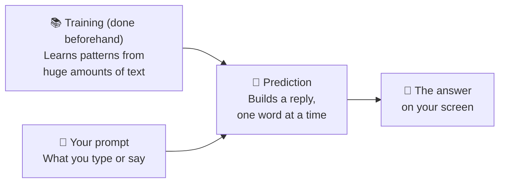

> 👋 **A different kind of post.** Most of this blog is written for software engineers. This one is for everyone else — share it with the parent, neighbour, or friend who has just started asking Gemini or ChatGPT things. (Developers: the engineering version is [Prompt Engineering for Software Engineers](https://krishnamohan-seelam.github.io/my-blog/prompt-engineering/ai-coding/llm/2026/08/08/prompt-engineering-for-software-engineers.html).)

## The assistant that's already in your pocket

If you own an Android phone in India, you're already carrying a generative AI tool — whether you asked for it or not. Android runs on roughly 93% of smartphones in the country,<a href="#ref-1">1</a> and Google has spent the last two years turning "Hey Google" from a simple voice command into a full AI conversation: Google is upgrading Google Assistant to Gemini on mobile phones,<a href="#ref-2">2</a> and has rolled out the Gemini app in India with support for English and nine Indian languages — Hindi, Bengali, Gujarati, Kannada, Malayalam, Marathi, Tamil, Telugu, and Urdu.<a href="#ref-3">3</a>

People have noticed. India downloaded generative AI apps over 602 million times in 2025 — more than any other country in the world, and a 207% jump from the year before.<a href="#ref-4">4</a> By early 2026, OpenAI's Sam Altman said India had crossed 100 million weekly active ChatGPT users, making it one of the two largest ChatGPT markets on earth, with the largest number of student users of any country.<a href="#ref-5">5</a> OpenAI even built a cheaper plan, ChatGPT Go, for India first — ₹399 a month, payable by UPI.<a href="#ref-6">6</a> And on the laptop side, Microsoft's Copilot comes built into every Windows 11 PC, a click away on the taskbar.<a href="#ref-7">7</a> Even back in 2023, a Salesforce survey found 73% of Indians online were already using generative AI in some form<a href="#ref-8">8</a> — for homework help, product research, drafting messages, planning trips, and asking things they'd have typed into a search bar a few years ago.

This is happening faster than most people are being taught how to do it well. Software engineers talk about "prompt engineering" like it's a technical skill. It mostly isn't — it's clear communication, the same thing a helpful stranger would need from you. Be specific, say what you actually want, check anything that matters before you rely on it, and don't hand over anything you wouldn't hand a stranger. This guide walks through all of it in plain language, with the research behind every claim linked at the bottom — tap any small number to jump to its source — so you can check it yourself, which, as you'll see, is exactly the habit this guide is trying to teach.

> 📌 **Short on time? The five-point version:**
>
> 1. **Say it fully.** What you want, who it's for, the details that matter, and the shape of the answer.
> 2. **Check what matters.** For money, health, law, or deadlines, open the source or ask a professional.
> 3. **Don't trust confidence.** It rarely says "I don't know," and it tends to agree with you.
> 4. **Keep your numbers private.** No Aadhaar, PAN, bank details, OTPs, or UPI PIN — ever.
> 5. **Think first, then ask.** Use it to check your work, not to replace your thinking.

---

## First things first: what is GenAI, and how does it work?

You don't need to understand the engineering to use these tools well. But a rough picture of what's happening inside makes almost every tip in this guide make sense.

### What "generative AI" means

**Generative AI** — GenAI for short — is software that *creates* something new in response to what you ask: a paragraph, a letter, a picture, a summary, a translation. Google describes it simply as a type of machine learning model that "can help you create new content, like images, music, and code."<a href="#ref-9">9</a>

That's different from the tools most of us grew up with:

| Tool | What it does | Example |
|---|---|---|
| **Search engine** (classic Google Search) | *Finds* existing web pages and shows you a list of links | "Chennai to Madurai trains" → links to IRCTC and travel sites |
| **Old-style voice assistant** (classic Google Assistant) | *Follows* a fixed command | "Set an alarm for 6 am" → alarm set |
| **GenAI assistant** (Gemini, ChatGPT, Copilot, Grok) | *Writes* a fresh answer every time, in whatever form you ask for | "Plan a two-day Madurai trip for my parents, who can't walk much" → a custom plan, written for them |

A few words you'll see in this guide:

- **Prompt** — whatever you type or say to the assistant.
- **Chatbot** or **AI assistant** — the app you talk to: Gemini, ChatGPT, Copilot, Grok, and similar.
- **Large language model (LLM)** — the "engine" inside the chatbot that produces the words. You never deal with it directly.
- **Hallucination** — the industry's word for when the AI confidently makes something up.

### The big three in India: Gemini, ChatGPT, and Copilot

Most people in India meet GenAI through one of three assistants — often whichever one came with their device. They work the same basic way, so every tip in this guide applies to all three (and to others like Grok, Perplexity, or Meta AI). Where they differ is in where you find them, what they cost, and which languages they handle:

| | Gemini | ChatGPT | Copilot |
|---|---|---|---|
| **Made by** | Google | OpenAI | Microsoft |
| **Where you'll find it** | Built into Android phones — say "Hey Google" or open the Gemini app | The ChatGPT app (Play Store / App Store) or chatgpt.com | Built into Windows 11 — the taskbar icon or the Copilot key on newer laptops — plus the Copilot phone app<a href="#ref-7">7</a> |
| **Cost** | Free, with paid plans for heavier use | Free, or ChatGPT Go at ₹399/month via UPI<a href="#ref-6">6</a> — Indian users who signed up from November 2025 got Go free for 12 months<a href="#ref-10">10</a> | Free with a Microsoft account |
| **Indian languages** | English + 9 Indian languages, typed or spoken<a href="#ref-3">3</a> | App menus and chat in 10 Indian languages, including Hindi, Bengali, Tamil, Telugu, and Punjabi<a href="#ref-11">11</a> | Typed chat officially supports Hindi; voice supports 10 Indian languages<a href="#ref-12">12</a> |
| **Especially handy for** | Everyday phone tasks alongside Google apps you already use | Writing, explaining, and studying — India has more student users than any other country<a href="#ref-5">5</a> | Help while working on a Windows laptop — emails, documents, and questions about your PC |

> 💡 **Which one should you use?** The one you'll actually open. The habits in this guide matter far more than the choice of assistant — and for anything important, asking two of them the same question is a quick way to spot a made-up answer.

### How it works: your phone's autocomplete, scaled up enormously

You've already used a tiny version of this technology. When you type *"Happy birthday, have a…"* on your phone keyboard, it suggests *"great"* or *"wonderful"* — because it has learned which words usually come next.

A GenAI assistant works on the same basic idea, at a vastly larger scale. Google explains that these models learn "through a process of observation and pattern matching known as training," using enormous amounts of text, and then "predict words that might come next based on your prompt."<a href="#ref-9">9</a> So when you ask a question, it isn't pulling out one stored, checked answer. It builds a reply word by word, each time choosing what is most likely to fit, based on the patterns it absorbed during training.

Think of a very well-read friend who has read millions of books, websites, and articles but has no notes to check — they answer from memory, fluently and instantly. Usually they're right. Sometimes they mix things up, and they sound exactly as sure either way.

### Why this matters for you

That one fact — *it predicts likely words; it doesn't look up verified facts* — explains most of what follows:

- **Why your details matter.** The prediction is shaped by what you give it. A vague question gets a "what most people would want" answer; a detailed one gets an answer for *you*. (Sections 1 and 2)
- **Why it can be confidently wrong.** In Google's own words, these models "don't gather information at all" — they predict — which is why they sometimes "invent an answer."<a href="#ref-9">9</a> A made-up answer reads just as smoothly as a correct one. (Sections 3 and 4)
- **Why it can be out of date.** What it learned in training stops at a certain point.<a href="#ref-9">9</a> Many assistants now also run a quick web search and summarise what they find, but they can still misread or misquote those sources — sourcing was the biggest single problem in one major international audit.<a href="#ref-13">13</a> (Section 3)
- **Why it's one tool for many jobs.** A recipe, a leave letter, a poster for a school function — it's the same predict-and-create engine each time. Only your prompt changes.

### What it can do for you today

| It can… | Everyday example |
|---|---|
| **Explain** | "Why does milk boil over but water doesn't? Explain simply." |
| **Write and rewrite** | A leave application, a wedding invitation message, a polite reply to a housing society notice |
| **Translate and simplify** | Turn an English school circular into simple Hindi for grandparents |
| **Summarise** | Boil a long government PDF or a lengthy WhatsApp forward down to five key points |
| **Understand photos** | Point your camera at a plant with spotted leaves, a confusing form, or a menu in another language |
| **Create images** | A poster for your colony's Ganesh Chaturthi celebration |
| **Talk by voice** | Say "Hey Google" and ask in Tamil, Marathi, or Bengali<a href="#ref-3">3</a> |

Now that you know what's happening inside, here's how to get the best out of it.

---

## 1. How to use it: give it four things

Most disappointing answers come from a vague question, not a broken tool. Before you hit send (or finish speaking), try to include:

1. **What you want** — a list, a paragraph, a comparison, step-by-step instructions.
2. **Who it's for** — you, your child, a beginner, an elderly parent, someone with a specific need.
3. **The details that matter** — your budget in rupees, your city, the ingredients you have, the deadline.
4. **What shape the answer should take** — "three bullet points," "one paragraph," "a table," "in simple Hindi."

This is the same advice OpenAI gives ChatGPT users — be specific, give context, and describe the output you want<a href="#ref-14">14</a> — and Google gives nearly identical advice for Gemini, framed as *who it should act as, what to do, the background, and the format*.<a href="#ref-15">15</a>

> **Vague:** "Tell me about water purifiers."
>
> **Framed:** "I'm buying my first water purifier for a family of four in an apartment in Bengaluru with corporation-supplied tap water. Budget under ₹8,000, low-maintenance. Give me three options as a short table: brand, price, one pro, one con."

The second version isn't more "technical" — it just tells the assistant what a helpful neighbour would already know before recommending anything.

### More everyday examples: vague vs. framed

**🍳 Cooking**

> ❌ "Give me a dinner recipe."
>
> ✅ "I have leftover rice, two eggs, an onion, and capsicum. Suggest one dinner for two that takes under 20 minutes, no oven. List the steps in short numbered points."

**✉️ Writing a complaint**

> ❌ "Write a complaint to the electricity board."
>
> ✅ "Write a polite but firm complaint to my electricity board in simple English. My bill for August is ₹4,200, about three times my usual ₹1,400, with no change in usage. Ask them to check the meter reading. Keep it under 150 words."

**👵 Helping a parent**

> ❌ "Explain how to use UPI."
>
> ✅ "Explain to my 68-year-old mother, in simple Telugu, how to check her bank balance in a UPI app. Use short steps, and remind her never to share her UPI PIN with anyone."

**💼 Job hunting**

> ❌ "Improve my resume."
>
> ✅ "Here's my resume summary [paste it — with your phone number and address removed]. I'm applying for a customer-support role at an e-commerce company. Rewrite it in three lines that highlight my Hindi and Kannada skills."

**📄 Understanding a document**

> ❌ "What does this mean?"
>
> ✅ "Explain this paragraph from my rental agreement in plain language, and tell me what questions I should ask my landlord before signing. [paste the paragraph]"

**🩺 Health (low-risk use)**

> ❌ "Is my report okay?"
>
> ✅ "What does 'HbA1c' measure in a blood test, and what questions should I ask my doctor about it? Don't interpret my numbers — I'll discuss those with my doctor."

### It also works for homework, search, and creative tasks

**Homework / learning.** Say the grade or board and how much you already know, and ask it to explain rather than just hand you the answer — e.g. *"Explain photosynthesis the way you'd teach a CBSE Class 7 student, then give me two practice questions. Don't give me the answers until I try."* An answer with no explanation is easy to copy without understanding it — that gap is exactly what researchers are starting to measure (more on that in Section 6).

**Search / "what should I do."** Add your constraints up front — city, budget, season — and ask for options, not a single verdict — e.g. *"Weekend trip ideas within four hours of Bengaluru by car, budget ₹6,000 total for two people, during the monsoon."* Treat the answer as a shortlist to check, not a decision already made.

**Creative tasks.** Describe the audience, mood, and length before style — e.g. *"A 30-second Diwali greeting for my apartment building's WhatsApp group — warm, a little funny, mentions our terrace get-together."* Creative prompts reward more detail, not less, because there's no single "correct" answer to fall back on.

### Talking to it in your own language

Typing a long, detailed prompt in English isn't always the easiest option — and it doesn't have to be. Gemini on Android supports voice and text in Hindi, Bengali, Gujarati, Kannada, Malayalam, Marathi, Tamil, Telugu, and Urdu, alongside English.<a href="#ref-3">3</a> The same "give it four things" approach works whether you type or speak, and whether you ask in English or your own language. You can even mix: *"Answer in simple Hindi, but keep the medicine names in English so I can match them to the strip."*

---

## 2. Get it right the first time: fewer back-and-forth rounds

Many people send a short question, get a so-so answer, then spend five more messages correcting it. Google has noticed this too: looking at Gemini in its Workspace apps (Gmail, Docs and the like), it found the most successful prompts averaged around 21 words — while people's first attempts were "significantly shorter."<a href="#ref-15">15</a> A little more effort in the first message usually saves several rounds later. Some habits that help:

- **Front-load everything you already know.** If you'd end up saying "no, my budget is ₹15,000" in message three, put it in message one.
- **Say what you *don't* want.** *"Only brands with a service centre in my city," "no recipes with onion or garlic," "don't use difficult English words."* Exclusions cut out whole rounds of "not that one."
- **Ask it to ask you first.** For anything with many moving parts, try: *"Before you answer, ask me up to five questions you need to give me a good answer."* It gathers the missing details in one go instead of guessing.
- **Show an example of what you like.** *"Write it in the same style as this message I sent last year: [paste]."* One example often beats a paragraph of description.
- **Ask for options in one go.** *"Give me three versions — one formal, one friendly, one very short."* Picking from three beats asking for a redo three times.
- **Share a photo instead of describing it.** Most of these apps let you attach a picture. A photo of a plant's leaves, a confusing form, or a product label often says more than a long description (but see Section 5 before photographing anything with personal details on it).
- **Stay in the same chat when refining.** The assistant remembers what you said earlier in the same conversation, so *"make it shorter"* or *"now in Marathi"* works. Starting a fresh chat throws that context away.
- **Save prompts that work.** If a prompt gave you exactly the kind of weekly meal plan you wanted, keep it in your notes and reuse it next week with small changes.

> **Before (four rounds):** "Plan a birthday party." → "It's for my son." → "He's turning 8." → "At home, budget ₹5,000, 12 kids."
>
> **After (one round):** "Plan a home birthday party for my son turning 8. About 12 kids, budget ₹5,000 total, 3–6 pm on a Sunday in Pune. Give me a simple schedule, three game ideas that need no special equipment, and a snack list with rough costs."

---

## 3. How to verify: match your checking to the stakes

Not every task carries the same risk if the AI gets it wrong. A dinner recipe suggestion and a medicine dosage question don't deserve the same scrutiny:

- **Low stakes** (recipe ideas, brainstorming, greeting messages, first drafts): use the answer freely, revise as you go.
- **Medium stakes** (product research, travel planning, general knowledge, homework explanations): check the specific facts and numbers before acting.
- **High stakes** (medical, legal, financial, tax, or a rental/loan agreement): treat the AI's answer as a starting question for a doctor, lawyer, chartered accountant, or bank — never as the final word. AI chatbots are not a substitute for reading the fine print on an EMI schedule or a rental agreement yourself, or for a qualified professional's opinion.

### Don't skip the click

For anything medium or high stakes, checking is the part most people skip — and it's the single biggest gap between how these tools are used and how they should be used.

| Finding | Detail |
|---|---|
| **45%** of AI news answers had a significant issue | 2025 audit of ChatGPT, Copilot, Gemini & Perplexity, across 22 public broadcasters in 18 countries<a href="#ref-13">13</a> |
| **26–56%** of chatbot users click through to the original source | Varies by country; in many countries, fewer than half ever open the source behind the AI's summary<a href="#ref-16">16</a> |

In other words: the tools usually do give you a way to check their work, but many people don't use it. A quick verification habit closes most of the gap:

- Ask it directly: "what's your source for that?" — and then actually open the link.
- For anything time-sensitive (news, prices, exam dates, train/flight schedules, government scheme deadlines), assume it could be outdated and check a primary source — the company's own site, the official notification, the original article.
- Be extra cautious with anything that arrives secondhand — a forwarded WhatsApp message claiming "AI confirmed this" is not the same as checking the source yourself.
- Be extra cautious on recent or contested topics — that's where error rates are highest.<a href="#ref-13">13</a>

> **Example:** You ask, *"What's the last date to file my income tax return this year?"* and get a confident date. Before you plan around it, check the Income Tax Department's official website. Deadlines are sometimes extended or changed from year to year, and a chatbot may be repeating last year's information.

---

## 4. The traps: two patterns worth knowing

### It answers even when it should say "I don't know"

A year-long tracking study of ten major chatbots found the rate of false claims on contested news topics nearly doubled, from 18% to 35%, over twelve months.<a href="#ref-17">17</a> The cause wasn't that the models got worse at reasoning — it's that they got worse at declining to answer. The share of prompts where a chatbot said "I don't have enough information" fell from 31% to close to 0% over the same period.<a href="#ref-17">17</a> The tools are now built to always give you something, so a confident-sounding answer is not proof of correctness.

### It tends to agree with you

Researchers at Stanford tested 11 major chatbots on interpersonal advice questions and found they endorsed the person asking — even in ethically questionable situations — about 49% more often than a typical human respondent would.<a href="#ref-18">18</a> People preferred the agreeable answer, but it also left them feeling more certain they were right and less willing to consider other views.<a href="#ref-18">18</a> If you're using an AI to settle a family argument or check a decision you've already made, it has a documented tendency to just tell you what you want to hear.

> 💡 **A counter-move:** ask it to argue the other side. *"Now give me the strongest case for why I might be wrong."*

---

## 5. Stay safe: privacy and security

AI assistants are useful precisely because you can tell them anything. That's also why you should be careful about what you tell them — and about what others can now do with AI.

### What you type may be read by a person and kept for years

Google's own privacy page for Gemini says trained human reviewers read some conversations to improve the product, that chats selected for review are kept for up to three years — even if you delete your activity — and asks users directly: *"Please don't enter confidential information that you wouldn't want a reviewer to see or Google to use to improve our services."*<a href="#ref-19">19</a> OpenAI similarly uses ChatGPT conversations to train its models unless you switch that off.<a href="#ref-20">20</a>

**Never type, paste, or photograph:**

- Aadhaar, PAN, passport, or voter ID numbers — or photos of these cards
- Bank account numbers, card numbers, CVV, UPI PIN, net-banking passwords, or any OTP
- Full medical reports with your name, age, and hospital ID on them
- Other people's private details — a friend's phone number, a colleague's salary, a family member's health condition
- Office documents your employer hasn't allowed you to share

If you need help understanding a document, **cover or crop out** the name, number, and address first, or type out only the paragraph you need explained.

### Settings worth changing

- **Gemini:** open [Gemini Apps Activity](https://myactivity.google.com/product/gemini) and turn off *Keep Activity* to stop future chats being saved and used for training. For a one-off sensitive question, use a **temporary chat**, which Google says is not kept beyond 72 hours or used for training.<a href="#ref-19">19</a>
- **ChatGPT:** go to *Settings → Data Controls* and switch off *"Improve the model for everyone,"* or use **Temporary Chat** for conversations you don't want saved or used for training.<a href="#ref-20">20</a>
- **Copilot:** tap your profile icon, go to *Privacy* (in the phone app: *Account → Privacy*), and switch off *Training on conversation activity* and *Training on voice conversations*. Microsoft notes this stops future chats being used to train its AI, but they can still be used for things like safety checks and advertising — so the "never type" list above still applies.<a href="#ref-21">21</a>

### AI can now fake a familiar voice or face

The same technology that writes your birthday message can copy a person's voice from a few seconds of audio. In a 2023 McAfee survey, 47% of Indian adults said they had experienced an AI voice scam or knew someone who had; 83% of Indian victims said they lost money, and 69% of Indians weren't confident they could tell a cloned voice from a real one.<a href="#ref-22">22</a> The tools have only become cheaper and more convincing since. The typical script is an urgent call from a "family member" in trouble — an accident, an arrest, a lost wallet abroad — asking for money right now.

**Protect yourself and your family:**

- **Agree on a family code word** that only you know, and ask for it if a "relative" calls in an emergency asking for money.
- **Hang up and call back** on the number you already have saved. Scammers rely on urgency — a two-minute pause is your best defence.
- **Be suspicious of celebrity videos** promising guaranteed investment returns or free gifts. Faces and voices can be faked convincingly.
- **Never share an OTP or UPI PIN** — no real bank, company, or government office will ask for one over a call or chat, whether the voice sounds human or not.

### Everyday safety habits

- **Install AI apps only from the official store** (Google Play or the App Store) and check the publisher — "Google LLC" for Gemini, "OpenAI" for ChatGPT, "Microsoft Corporation" for Copilot. Lookalike apps with similar names and logos exist.
- **Be wary of "ChatGPT" or "Copilot" on WhatsApp.** Both official WhatsApp versions shut down on 15 January 2026 after a WhatsApp policy change.<a href="#ref-23">23</a> A WhatsApp number claiming to be either one today isn't the real thing — use the official app or website instead.
- **Don't blindly tap links an AI gives you** for payments, logins, or downloads. Type the official website address yourself.
- **Supervise young children's use.** Talk to them about what not to share, and check what they're asking.
- **Report fraud quickly.** If you've been cheated online, call the national cybercrime helpline **1930** or file a complaint at **cybercrime.gov.in**.<a href="#ref-24">24</a> Reporting fast improves the chance of stopping the money transfer.

---

## 6. The side effect: what happens if you lean on it too much

This is the newest and least settled area of research, so treat it as an early signal, not a verdict.

> Researchers at MIT's Media Lab studied 54 people writing essays with and without ChatGPT, using EEG to measure brain activity. The group using ChatGPT showed the weakest connectivity across the brain networks tied to memory, attention, and executive function, and many of them struggled to quote from essays they had just written. When that group later switched to writing without the tool, their brain engagement stayed lower than that of people who had written unaided from the start. The researchers named this pattern "cognitive debt."<a href="#ref-25">25</a>

A separate, larger survey of 666 people found a link between heavier AI use and lower critical-thinking scores, strongest among younger respondents, tied to a habit researchers call "cognitive offloading" — letting the tool think so you don't have to.<a href="#ref-26">26</a> That study found the two go together, not proof that AI use causes the drop, and the MIT study above is small (54 people). Neither proves permanent harm. But given how many students in India already use these tools for homework and exam prep,<a href="#ref-5">5</a> the pattern is worth taking seriously: using AI as a first draft you still think through works differently — and seems to cost less — than using it as a replacement for thinking.

**Ways to use it without leaning on it:**

- **Try first, then ask.** Attempt the maths problem or write your own draft, then ask the AI to check it and explain what you missed.
- **Ask it to quiz you**, not to do it for you: *"Ask me five questions on the Mughal empire for my Class 8 exam, one at a time, and tell me where I went wrong."*
- **Explain it back.** After reading an AI explanation, close the app and explain the idea in your own words to someone — or to yourself. If you can't, you haven't learned it yet.

---

## The one habit that covers most of this

You don't need to memorize all of the above. One habit does most of the work: **treat every answer as a first draft from a fast, confident, occasionally wrong assistant — and treat every chat as something a stranger might read.** Ask for its source. Click the source. Keep your personal numbers to yourself. And do your own thinking before you accept its conclusion, especially when it's telling you exactly what you hoped to hear.

**Next steps:** pick one thing you asked an AI this week and ask it again using the four-things framing from Section 1 — then compare the two answers. And if you write software for a living, [Prompt Engineering for Software Engineers](https://krishnamohan-seelam.github.io/my-blog/prompt-engineering/ai-coding/llm/2026/08/08/prompt-engineering-for-software-engineers.html) takes the same ideas into structured prompts, patterns, and production systems.

---

## References

| # | Resource | URL |
|---|---|---|
| 1 | Statcounter, "Mobile Operating System Market Share India" | <https://gs.statcounter.com/os-market-share/mobile/india> |
| 2 | Google Blog, "The Assistant experience on mobile is upgrading to Gemini" (March 2025) | <https://blog.google/products/gemini/google-assistant-gemini-mobile/> |
| 3 | Google India Blog, "Gemini in India: Now on Mobile, Multilingual, and More Powerful For Your Everyday Tasks" | <https://blog.google/intl/en-in/company-news/technology/gemini-in-india-now-on-mobile-multilingual-and-more-powerful-for-your-everyday-tasks/> |
| 4 | TechCrunch / Sensor Tower, "India's AI boom pushes firms to trade near-term revenue for users" (Feb 2026) | <https://techcrunch.com/2026/02/24/india-ai-boom-pushes-firms-to-trade-near-term-revenue-for-users/> |
| 5 | TechCrunch, "India has 100M weekly active ChatGPT users, Sam Altman says" (Feb 2026) | <https://techcrunch.com/2026/02/15/india-has-100m-weekly-active-chatgpt-users-sam-altman-says/> |
| 6 | TechCrunch, "OpenAI launches a sub-$5 ChatGPT plan in India" (August 2025) — ₹399/month, UPI payments | <https://techcrunch.com/2025/08/18/openai-launches-a-sub-5-chatgpt-plan-in-india> |
| 7 | Microsoft, "Copilot on Windows 11" | <https://www.microsoft.com/en-us/windows/learning-center/copilot-on-windows-11> |
| 8 | Salesforce, "Generative AI Statistics" — general-population survey of online adults in the U.S., UK, Australia and India (September 2023) | <https://www.salesforce.com/news/stories/generative-ai-statistics/> |
| 9 | Google, Gemini Apps Help, "Learn about generative AI" | <https://support.google.com/gemini/answer/13954172?hl=en> |
| 10 | TechCrunch, "OpenAI offers free ChatGPT Go for one year to all users in India" (October 2025) | <https://techcrunch.com/2025/10/27/openai-offers-free-chatgpt-go-for-one-year-to-all-users-in-india/> |
| 11 | OpenAI Help Center, "How to change your language setting in ChatGPT" | <https://help.openai.com/en/articles/8357869-how-to-change-your-language-setting-in-chatgpt> |
| 12 | Microsoft Support, "Supported regions and languages in Microsoft Copilot" | <https://support.microsoft.com/en-us/microsoft-copilot/supported-regions-and-languages-in-microsoft-copilot> |
| 13 | European Broadcasting Union & BBC, "News Integrity in AI Assistants" (October 2025) | <https://www.ebu.ch/research/open/report/news-integrity-in-ai-assistants> |
| 14 | OpenAI Help Center, "Prompt engineering best practices for ChatGPT" | <https://help.openai.com/en/articles/10032626-prompt-engineering-best-practices-for-chatgpt> |
| 15 | Google Blog, "5 ways to write better AI prompts for Gemini in the Workspace side panel" | <https://blog.google/products-and-platforms/products/workspace/google-gemini-workspace-ai-prompt-tips/> |
| 16 | Reuters Institute for the Study of Journalism, 2026 Digital News Report — chatbot click-through behaviour | <https://reutersinstitute.politics.ox.ac.uk/digital-news-report/2026/emerging-uses-ai-chatbots-news-and-what-it-means-journalism> |
| 17 | NewsGuard, "AI False Claims Monitor," one-year audit (September 2025) | <https://www.newsguardtech.com/press/newsguard-one-year-ai-audit-progress-report-finds-that-ai-models-spread-falsehoods-in-the-news-35-of-the-time/> |
| 18 | Stanford Report, "AI overly affirms users asking for personal advice" (March 2026) | <https://news.stanford.edu/stories/2026/03/ai-advice-sycophantic-models-research> |
| 19 | Google, "Gemini Apps Privacy Hub" | <https://support.google.com/gemini/answer/13594961?hl=en> |
| 20 | OpenAI Help Center, "Data controls in ChatGPT" | <https://help.openai.com/en/articles/7730893-data-controls-in-chatgpt> |
| 21 | Microsoft Support, "Microsoft Copilot privacy controls" | <https://support.microsoft.com/en-us/microsoft-copilot/microsoft-copilot-privacy-controls> |
| 22 | McAfee "Beware the Artificial Impostor" survey (April 2023, 7,054 adults in 7 countries incl. India), as reported by BOOM | <https://www.boomlive.in/explainers/ai-voice-scam-voice-cloning-mcafee-report-21851> |
| 23 | TechRadar, "Meta is kicking ChatGPT and Copilot out of WhatsApp" (November 2025) — WhatsApp Business policy change effective 15 January 2026 | <https://www.techradar.com/ai-platforms-assistants/apple-intelligence/meta-is-kicking-chatgpt-and-copilot-out-of-whatsapp-and-forcing-everyone-to-use-its-unpopular-ai-chatbot-instead> |
| 24 | Ministry of Home Affairs, National Cyber Crime Reporting Portal (helpline 1930) | <https://cybercrime.gov.in> |
| 25 | MIT Media Lab study, as reported by [TIME](https://time.com/7295195/ai-chatgpt-google-learning-school/) and the [Harvard Gazette](https://news.harvard.edu/gazette/story/2025/11/is-ai-dulling-our-minds/) (2025). Sample size: 54 participants — an early finding, not a settled conclusion. | <https://www.media.mit.edu/projects/your-brain-on-chatgpt/overview/> |
| 26 | Michael Gerlich, "AI Tools in Society: Impacts on Cognitive Offloading and the Future of Critical Thinking," *Societies*, 2025 — 666 participants; found a link, not proof of cause | <https://www.mdpi.com/2075-4698/15/1/6> |
